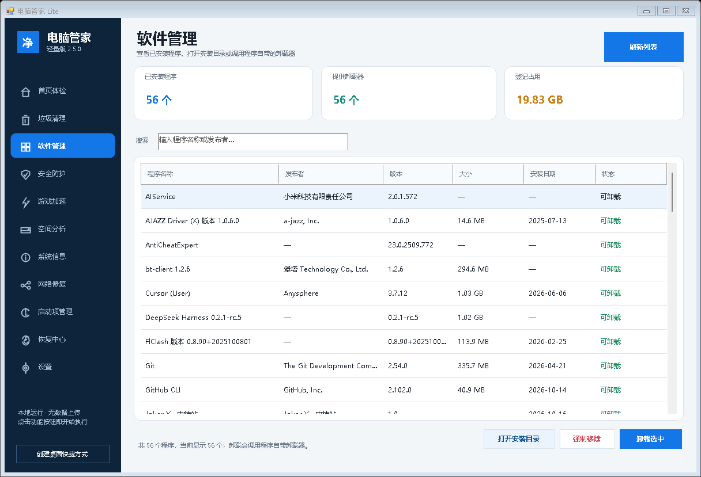
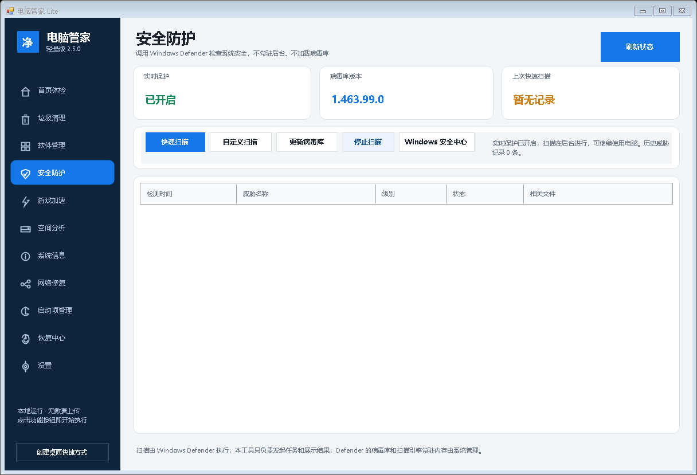

<p align="center"></p>

# 电脑管家 Lite

一个面向 Windows 10/11 的轻量单文件电脑管家。功能集中在垃圾清理、游戏加速、通用帧时间诊断、网络修复、启动项管理和系统设置恢复。

官网下载页：[jokerx.top · 软件管理](https://jokerx.top/projects/software/index.html)

当前版本：`2.5.0`

## 截图







## 功能

- **内置更新**：只从 `jokerx.top` 检查、下载和校验更新，不经过 GitHub 代理；安装前验证 SHA-256，检查超时会自动结束。
- **主题与启动**：支持跟随系统、浅色、深色主题并即时切换，5 种强调色可选，以及可随时撤销的 Windows 开机自启动。
- **垃圾清理**：用户/Windows 临时文件、更新缓存、错误报告、缩略图、DirectX 与显卡缓存、浏览器缓存、系统日志、传递优化缓存、内存转储、开发工具缓存、可选 Windows.old 和回收站；支持全选/推荐项和一键清理，可配置每周自动清理。
- **软件管理**：读取已安装程序，显示发布者、版本、大小、安装日期和卸载器状态；支持搜索、打开安装目录、调用自带卸载器、等待卸载结束并自动刷新，卸载器缺失时可强制移除登记信息和（可选）安装目录。
- **安全防护**：读取 Windows Defender 实时保护、病毒库和扫描状态，支持快速扫描、自定义文件夹扫描、更新病毒库、查看历史威胁并跳转 Windows 安全中心；本工具不常驻、不加载病毒库，内存占用接近零。
- **空间分析**：磁盘占用卡片 + 大文件扫描（只读），按大小排序，可直接打开所在位置。
- **系统信息**：处理器、显卡、内存条、磁盘、系统版本和开机时长的一屏概览。
- **游戏加速**：识别 Steam 游戏和前台全屏游戏，选择性关闭后台程序，优化 Game Mode、Game DVR 和电源计划，并可单独清理 DirectX/显卡着色器缓存。
- **帧时间诊断**：调用本机已安装的 Intel PresentMon，统计平均 FPS、1% Low、平均帧时与卡顿次数。
- **网络修复**：检测网关、互联网延迟、丢包、抖动和 DNS，支持缓存刷新与 Winsock/TCP-IP 重置。
- **启动项管理**：扫描注册表 Run、启动文件夹和第三方自动服务，可禁用并恢复，支持关键字过滤。
- **恢复中心**：恢复本工具修改、创建 Windows 还原点、打开系统还原和操作日志。

## 安全策略

- 清理只处理已经解析为具体路径的白名单项目。
- 默认跳过最近 24 小时内修改或创建的文件。
- 不跟随 junction、符号链接或云端占位文件。
- 每次删除前重新验证目标仍位于扫描根目录。
- 不使用注册表清理，不清理 Prefetch，不强制删除正在使用的文件。
- 禁用启动服务只修改启动类型，不结束当前正在运行的服务。
- 所有修改记录写入本地日志，系统设置和启动项均提供恢复。
- 无遥测、无账号、无后台常驻监控。
- 开机自启动默认关闭，只能在设置页主动开启。

功能按钮点击后立即执行，不再弹出二次确认。清理范围、启动项勾选状态和系统选项会直接决定本次操作。只有「卸载程序」「强制移除」会弹出确认：卸载会交给第三方卸载器接管；强制移除会删除注册表卸载登记，删除安装目录还需要单独确认。

## 系统要求

- Windows 10 x64 / Windows 11 x64
- .NET Framework 4.8
- 管理员权限
- 帧时间诊断需要本机已安装 Intel PresentMon 或 NVIDIA FrameView

## 下载

- 本站：[pc-manager-lite.exe](https://jokerx.top/downloads/pc-manager-lite/pc-manager-lite.exe)
- 版本信息：[version.js](https://jokerx.top/downloads/pc-manager-lite/version.js)
- GitHub Releases 同样提供可执行文件。

## Windows 提示“风险”怎么办

程序使用 .NET Framework 单文件发布，**没有购买商业代码签名证书**，所以 SmartScreen 和部分杀毒软件会对新版本给出“未知发布者/风险”提示。这不是程序行为异常，主要取决于文件信誉和签名状态。

可以这样确认文件没有被篡改：

1. 打开 `https://jokerx.top/downloads/pc-manager-lite/version.js`，记下 `sha256`。
2. 本地执行 `Get-FileHash .\pc-manager-lite.exe -Algorithm SHA256`，两者一致即可。
3. GitHub Release 的 `pc-manager-lite.exe` 资产也带有 GitHub 计算的 SHA-256。
4. 也可以把 SHA-256 粘贴到 [VirusTotal](https://www.virustotal.com/gui/home/search) 查看多家引擎的扫描结果。

如果确认是误报，可以到 [Microsoft 文件误报提交](https://www.microsoft.com/en-us/wdsi/filesubmission) 上传该文件，通常 1–3 个工作日会更新签名库。

要彻底消除 SmartScreen 提示，需要 OV/EV 代码签名证书。构建脚本已预留签名入口：

```powershell
$env:SIGN_PFX = "C:\path\cert.pfx"
$env:SIGN_PASSWORD = "证书密码"
powershell -ExecutionPolicy Bypass -File .\build.ps1
```

设置后会自动调用 Windows SDK 的 `signtool.exe` 做 SHA-256 时间戳签名；没有证书时脚本会跳过签名。

## 从源码构建

仓库使用 Windows 自带的 .NET Framework C# 编译器，无第三方构建依赖。

```powershell
powershell -ExecutionPolicy Bypass -File .\build.ps1
```

输出：

```text
dist\pc-manager-lite.exe
```

源码主要文件：

- `src/ManagerUi.cs`：WinForms 界面、页面导航、交互。
- `src/ManagerServices.cs`：清理、游戏识别、PresentMon、网络、启动项和恢复服务。
- `src/app.manifest`：管理员权限和 DPI 声明。

## 本地数据

```text
%LOCALAPPDATA%\PcManagerLite\
```

其中包含设置备份、启动项恢复记录、清理审计日志、运行日志和可选帧采样 CSV。

## 设计参考

以下开源项目仅作为功能分组和交互设计的参考，本仓库没有复制它们的代码：

- [Winhance](https://github.com/memstechtips/Winhance)：可搜索的软件管理、强调色与偏好设置布局。
- [Dism++](https://github.com/Chuyu-Team/Dism-Multi-language)：系统信息与磁盘概览的组织方式。
- [winutil](https://github.com/ChrisTitusTech/winutil)：按用途分组的功能面板。
- [FluentCleaner](https://github.com/builtbybel/FluentCleaner)：清理分类与安全提示的呈现。
- [ContextMenuManager](https://github.com/BluePointLilac/ContextMenuManager)：右键菜单管理的思路（本版本未集成该高风险功能）。

## 第三方项目

- [BitBroom](https://github.com/pwnapplehat/BitBroom)（MIT）：清理安全策略与部分安全分类参考。
- [FluentCleaner](https://github.com/builtbybel/FluentCleaner)（MIT）：分类清理交互参考。
- [Intel PresentMon](https://github.com/GameTechDev/PresentMon)（MIT）：调用本机安装版本进行帧时间采集。

完整许可见 [THIRD-PARTY-NOTICES.txt](THIRD-PARTY-NOTICES.txt)。

本项目未导入 Winapp2.ini 删除数据库，也没有使用来源不明的 FPS Boost 脚本。

## License

[MIT](LICENSE)
