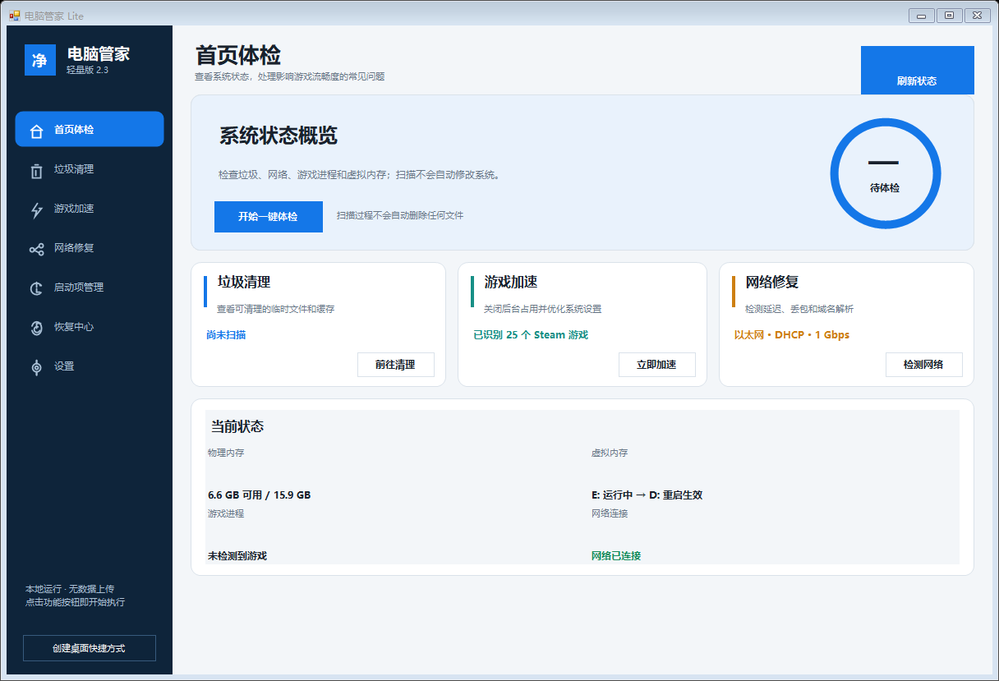
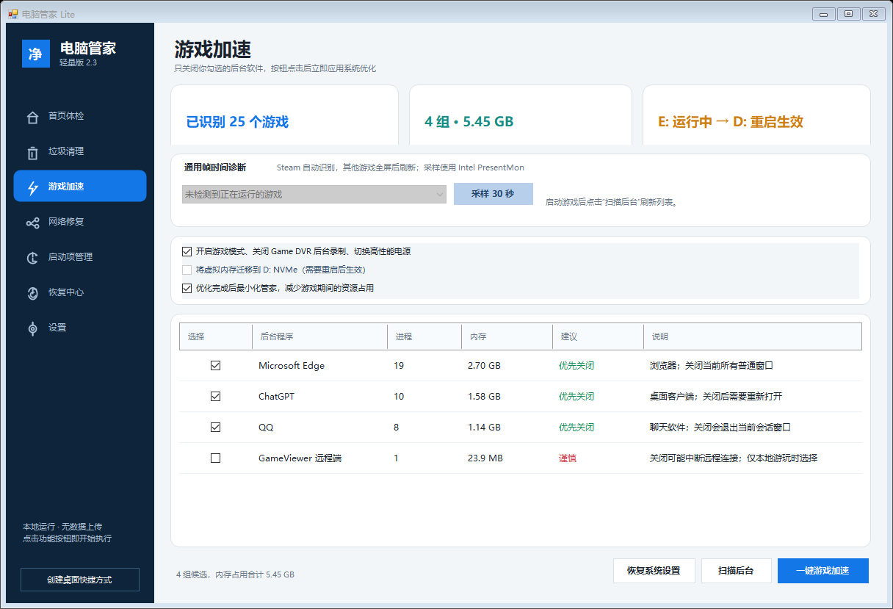
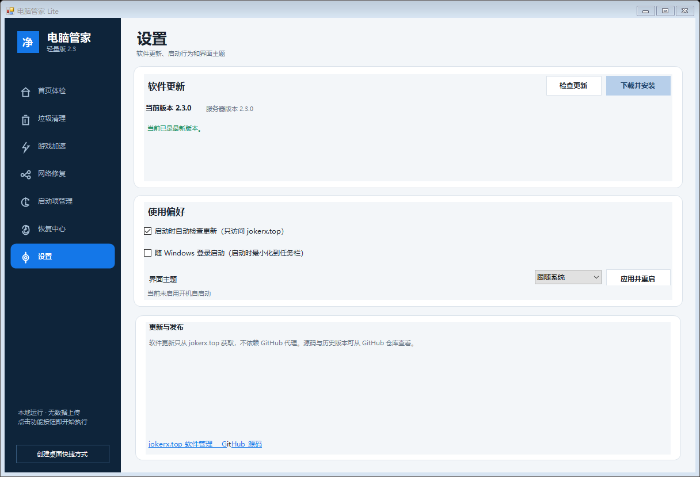

# 电脑管家 Lite

一个面向 Windows 10/11 的轻量单文件电脑管家。功能集中在垃圾清理、游戏加速、通用帧时间诊断、网络修复、启动项管理和系统设置恢复。

官网下载页：[jokerx.top · 软件管理](https://jokerx.top/projects/software/index.html)

当前版本：`2.3.0`

## 截图







## 功能

- **内置更新**：只从 `jokerx.top` 检查、下载和校验更新，不经过 GitHub 代理；安装前验证 SHA-256。
- **主题与启动**：支持跟随系统、浅色、深色主题，以及可随时撤销的 Windows 开机自启动。
- **垃圾清理**：用户/Windows 临时文件、Windows 更新缓存、错误报告、缩略图、DirectX 与显卡着色器缓存、浏览器缓存、回收站。
- **游戏加速**：识别 Steam 游戏和前台全屏游戏，选择性关闭后台程序，优化 Game Mode、Game DVR 和电源计划。
- **帧时间诊断**：调用本机已安装的 Intel PresentMon，统计平均 FPS、1% Low、平均帧时与卡顿次数。
- **网络修复**：检测网关、互联网延迟、丢包、抖动和 DNS，支持缓存刷新与 Winsock/TCP-IP 重置。
- **启动项管理**：扫描注册表 Run、启动文件夹和第三方自动服务，可禁用并恢复。
- **恢复中心**：恢复本工具修改、创建 Windows 还原点、打开系统还原和操作日志。

## 安全策略

- 清理只处理已经解析为具体路径的白名单项目。
- 默认跳过最近 24 小时内修改或创建的文件。
- 不跟随 junction、符号链接或云端占位文件。
- 每次删除前重新验证目标仍位于扫描根目录。
- 不使用注册表清理，不清理 Prefetch，不强制删除正在使用的文件。
- 禁用启动服务只修改启动类型，不结束当前正在运行的服务。
- 所有修改记录写入本地日志，系统设置和启动项均提供恢复。
- 无遥测、无账号、无后台常驻监控、无开机自启动。
- 开机自启动默认关闭，只能在设置页主动开启。

功能按钮点击后立即执行，不再弹出二次确认。清理范围、启动项勾选状态和系统选项会直接决定本次操作。

## 系统要求

- Windows 10 x64 / Windows 11 x64
- .NET Framework 4.8
- 管理员权限
- 帧时间诊断需要本机已安装 Intel PresentMon 或 NVIDIA FrameView

## 下载

- 本站：[pc-manager-lite.exe](https://jokerx.top/downloads/pc-manager-lite/pc-manager-lite.exe)
- 版本信息：[version.js](https://jokerx.top/downloads/pc-manager-lite/version.js)
- GitHub Releases 同样提供可执行文件。

程序未签名，首次运行可能出现 SmartScreen“未知发布者”。请以本仓库和 `jokerx.top` 的 SHA-256 信息为准。

## 从源码构建

仓库使用 Windows 自带的 .NET Framework C# 编译器，无第三方构建依赖。

```powershell
powershell -ExecutionPolicy Bypass -File .\build.ps1
```

输出：

```text
dist\电脑管家-Lite.exe
```

源码主要文件：

- `src/ManagerUi.cs`：WinForms 界面、页面导航、交互。
- `src/ManagerServices.cs`：清理、游戏识别、PresentMon、网络、启动项和恢复服务。
- `src/app.manifest`：管理员权限和 DPI 声明。

## 本地数据

```text
%LOCALAPPDATA%\PcManagerLite\
```

其中包含设置备份、启动项恢复记录、清理审计日志、运行日志和可选帧采样 CSV。

## 第三方项目

- [BitBroom](https://github.com/pwnapplehat/BitBroom)（MIT）：清理安全策略与部分安全分类参考。
- [FluentCleaner](https://github.com/builtbybel/FluentCleaner)（MIT）：分类清理交互参考。
- [Intel PresentMon](https://github.com/GameTechDev/PresentMon)（MIT）：调用本机安装版本进行帧时间采集。

完整许可见 [THIRD-PARTY-NOTICES.txt](THIRD-PARTY-NOTICES.txt)。

本项目未导入 Winapp2.ini 删除数据库，也没有使用来源不明的 FPS Boost 脚本。

## License

[MIT](LICENSE)
